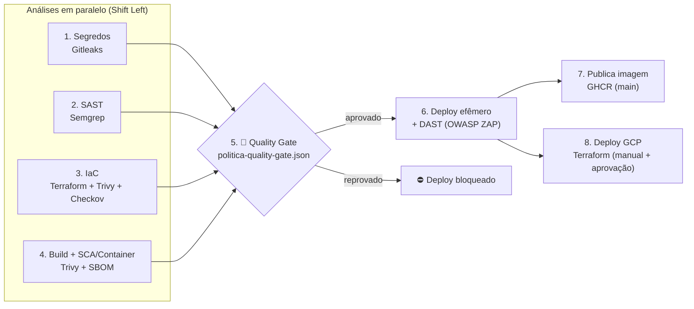

# 🧃 Guia Prático 03 — Esteira DevSecOps completa com o OWASP Juice Shop (Aula 03)

Na **Aula 02** vimos Git, Terraform (`fmt`, `init`, `validate`, `plan`, `apply`), Docker (imagens, camadas, registry) e o conceito de **Quality Gate**. Hoje juntamos tudo em uma **esteira DevSecOps de verdade** no GitHub Actions, que leva o **OWASP Juice Shop** (uma aplicação *propositalmente vulnerável*) do código até o deploy, passando por **6 camadas de segurança**.

> ⚠️ O Juice Shop é vulnerável **de propósito**. Nunca o exponha para a internet inteira e só execute ataques (DAST *full*) contra o **seu** ambiente de laboratório.

---

## 🎯 Objetivos da aula

Ao final você será capaz de:

1. Explicar **onde** cada tipo de teste de segurança entra na esteira (*Shift Left*);
2. Ler e interpretar relatórios de **Secret Scanning, SAST, SCA, Container Scan, IaC Scan e DAST**;
3. Configurar um **Quality Gate como código** e diferenciar *bloqueio* de *risco aceito*;
4. Proteger a **própria esteira** (Actions fixadas por hash, menor privilégio, checksum);
5. Fazer o deploy da aplicação aprovada (efêmero no runner e, opcionalmente, no GCP com Terraform).

---

## 🗺️ Visão geral da esteira

Arquivo: [`.github/workflows/devsecops-juice-shop.yml`](../.github/workflows/devsecops-juice-shop.yml)



| # | Camada | Ferramenta | O que procura | Analisa |
| :-: | :--- | :--- | :--- | :--- |
| 1 | **Secret Scanning** | Gitleaks | Senhas, tokens, chaves privadas | Histórico Git da turma + código do Juice Shop |
| 2 | **SAST** (estático) | Semgrep | Injeção, XSS, criptografia fraca, *eval*… (OWASP Top 10) | Código-fonte TypeScript/JavaScript |
| 3 | **IaC Scan** | `terraform fmt/validate`, Trivy, Checkov | Más configurações de nuvem e Dockerfile | `03-pratica-pipeline-devsecops/infra` e `app/Dockerfile` |
| 4 | **SCA + Container** | Trivy (+ SBOM CycloneDX) | CVEs em bibliotecas npm e no sistema da imagem | Imagem Docker construída |
| 5 | **Quality Gate** | `seguranca/quality_gate.py` | Compara achados x limites da política | Relatórios SARIF |
| 6 | **DAST** (dinâmico) | OWASP ZAP | Vulnerabilidades com a aplicação **rodando** | `http://localhost:3000` |
| 7 | **Registry** | GHCR | Guarda a imagem **aprovada** e versionada (hash do commit) | — |
| 8 | **Deploy IaC** | Terraform + GCP | Provisiona VM + firewall restrito | — |

### 📂 Estrutura desta prática

```
03-pratica-pipeline-devsecops/
├── GUIA_LAB_AULA03.md            ← este guia
├── app/Dockerfile                ← imagem do Juice Shop (versão fixa, USER não-root, HEALTHCHECK)
├── infra/                        ← Terraform GCP (VM Shielded, SA dedicada, firewall restrito)
│   ├── versions.tf  variables.tf  main.tf  outputs.tf  startup.sh.tftpl
└── seguranca/
    ├── politica-quality-gate.json  ← A POLÍTICA (o que bloqueia e o que é risco aceito)
    ├── quality_gate.py             ← o "juiz" que lê os relatórios e decide
    └── zap-rules.tsv               ← ajuste fino das regras do DAST
```

---

## 🧰 Parte 0 — Preparação (5 min)

Cada aluno trabalha na **sua própria cópia** do repositório, para ter a sua esteira, os seus relatórios e a sua aba *Security*.

1. Acesse https://github.com/LeandroOSBr/devsecops-tsc31262r e clique em **Fork** → **Create fork**;
2. No seu fork, abra a aba **Actions** e clique em **"I understand my workflows, go ahead and enable them"**;
3. Abra o seu fork no **Codespaces** (`<> Code` → `Codespaces` → `Create codespace on main`) ou clone localmente:

```bash
git clone https://github.com/<SEU-USUARIO>/devsecops-tsc31262r.git
cd devsecops-tsc31262r
```

---

## ▶️ Parte 1 — Primeira execução e leitura dos resultados (20 min)

1. No seu fork: **Actions** → **🧃 Esteira DevSecOps - Juice Shop (Aula 03)** → **Run workflow** → mantenha `baseline` e `nenhuma` → **Run workflow**;
2. Acompanhe o grafo de jobs: 1–4 rodam **em paralelo**, o **5. Quality Gate** espera todos, e só então vem o **6. DAST**;
3. Ao terminar, clique na execução e role até o **Summary**. Você verá a tabela do Quality Gate:

| Categoria | Modo | Resultado esperado |
| :--- | :--- | :--- |
| Segredos no repositório da turma | bloqueio | ✅ aprovado (nosso código não tem segredos) |
| Segredos no código do Juice Shop | relatorio | ⚠️ risco aceito (a aplicação tem chaves de propósito) |
| SAST (Semgrep) | relatorio | ⚠️ risco aceito |
| IaC - Terraform/Dockerfile (Trivy) | **bloqueio** | ✅ aprovado (infra escrita com boas práticas) |
| IaC - Checkov | relatorio | ✅ ou ⚠️ (compare com o Trivy!) |
| SCA + Container (Trivy image) | relatorio | ⚠️ risco aceito |
| DAST (OWASP ZAP) | relatorio | ⚠️ risco aceito |

4. Explore as evidências:
   - **Artifacts** (fim da página da execução): `relatorio-*` (SARIF, SBOM) e `relatorio-dast-zap` (abra o `report_html.html`);
   - **Security → Code scanning**: os achados de Gitleaks, Semgrep e Trivy aparecem como alertas, com arquivo e linha;
   - **Logs dos jobs**: as tabelas do Trivy (IaC e imagem) e do Checkov.

### ❓ Perguntas para discutir

- Por que o **SAST** encontra coisas que o **DAST** não encontra, e vice-versa?
- O Trivy de imagem achou CVEs em pacotes que **nós não escrevemos**. De quem é a responsabilidade? (Isso é **SCA**.)
- Para que serve o **SBOM** (`sbom-juice-shop.cdx.json`) no dia em que sair uma nova CVE crítica (lembre do Log4Shell)?
- Por que a esteira usa a **mesma imagem** (artefato `imagem.tar.gz`) no scan, no DAST e no registry, em vez de fazer um novo build a cada etapa?

---

## 🧪 Parte 2 — Exercícios práticos

Para cada exercício: crie uma branch, altere, faça commit/push e observe a esteira (ela dispara sozinha quando você altera a pasta `03-pratica-pipeline-devsecops/`).

### Exercício 1 — O Quality Gate de IaC bloqueando o deploy 🔒

```bash
git checkout -b lab03/ex1-iac-inseguro
```

1. Em [`infra/main.tf`](./infra/main.tf), **descomente** o bloco `google_compute_firewall "ssh_aberto_inseguro"` (remova o `/*` e o `*/`);
2. Rode localmente (opcional): `cd 03-pratica-pipeline-devsecops/infra && terraform fmt && terraform init -backend=false && terraform validate`;
3. `git add . && git commit -m "test: regra SSH aberta" && git push -u origin lab03/ex1-iac-inseguro`;
4. Resultado esperado: o Trivy aponta **GCP-0027 (CRITICAL)** — *firewall permite entrada de qualquer IP* — e o job **5. Quality Gate** fica ❌ **REPROVADO**. O DAST e o deploy **não executam**;
5. Corrija (comente de novo o bloco **ou** troque `0.0.0.0/0` pelo seu IP `/32`), faça novo push e veja a esteira voltar ao verde.

> 💡 Repare que o Terraform **também** tem uma "política como código": a variável `allowed_source_ranges` recusa `0.0.0.0/0` no bloco `validation`.

### Exercício 2 — Bloqueio x Risco aceito ⚖️

1. Abra [`seguranca/politica-quality-gate.json`](./seguranca/politica-quality-gate.json);
2. Mude a categoria `sast` (ou `container`) de `"modo": "relatorio"` para `"modo": "bloqueio"`;
3. Commit/push e observe: com o código vulnerável do Juice Shop, a esteira **para no Quality Gate**;
4. Agora experimente **ajustar o limite** (ex.: `"critical": 0, "high": 50`) e discuta:
   - Quem na empresa pode aprovar um "risco aceito"? Onde isso deve ficar registrado?
   - Faz sentido o mesmo limite para o **nosso** código e para um componente de **terceiros**?

### Exercício 3 — Vazou um segredo! 🔑

1. Gere o arquivo `03-pratica-pipeline-devsecops/config-exemplo.env` com um token **aleatório** (criado na hora, no seu terminal):

```bash
VALOR="$(openssl rand -hex 20)"
printf 'API_TOKEN = "%s"\n' "$VALOR" > 03-pratica-pipeline-devsecops/config-exemplo.env
cat 03-pratica-pipeline-devsecops/config-exemplo.env
```

> 💡 **Por que não colocamos o token pronto aqui no guia?** Porque na primeira versão deste guia ele estava escrito literalmente… e o Gitleaks bloqueou a esteira da turma inteira (Aula 03). Documentação, README e exemplos também vazam segredos! Veja o **Caso 0** do [Guia da Aula 04](../04-casos-de-uso/GUIA_LAB_AULA04.md).

2. Commit/push → o Gitleaks encontra `generic-api-key` e a categoria **Segredos no repositório da turma** (modo **bloqueio**) reprova a esteira;
3. Agora **apague** o arquivo, faça commit/push… e observe que a esteira **continua reprovando**. Por quê?
   - O Gitleaks varre o **histórico** (`gitleaks git`). O segredo continua nos commits anteriores!
   - **Lição:** segredo vazado = segredo **comprometido**. A resposta correta é **revogar/rotacionar** a credencial — reescrever o histórico (`git filter-repo`) é complemento, não solução.
4. Para encerrar o exercício, apague a branch (`git push origin --delete <branch>`) e volte para a `main`.

### Exercício 4 — DAST: passivo x ativo e validação manual 🕷️

1. **Actions → Run workflow** com `tipo_dast = full` (≈30 min, o ZAP **ataca** a aplicação dentro do runner);
2. Compare o `report_html.html` do *baseline* com o do *full*: quais alertas só aparecem no *full*? (ex.: *SQL Injection*, *XSS*);
3. **Valide um achado manualmente** (falso positivo ou verdadeiro?). Suba o Juice Shop no Codespaces:

```bash
docker run -d --rm -p 3000:3000 bkimminich/juice-shop:v20.3.0
```

   Abra a porta 3000 (aba **Ports**) e, na tela de login, use o e-mail `' OR 1=1--` com qualquer senha. Você entrou como **administrador**: injeção de SQL confirmada.

4. Abra `routes/login.ts` do Juice Shop (linha 34): a consulta SQL é montada concatenando `req.body.email`. Procure no relatório do **Semgrep** (Security → Code scanning, filtro `login.ts`) se essa linha foi apontada. Se foi, **SAST e DAST encontraram a mesma falha por caminhos diferentes**; se não foi, discuta: qual a limitação de um conjunto de regras genérico (falso negativo)?

### Exercício 5 — Segurança da própria esteira (Supply Chain) ⛓️

Abra o arquivo da esteira e responda:

1. Por que as Actions estão assim: `uses: aquasecurity/trivy-action@ed142fd0... # v0.36.0` e não `@v0.36.0`?
   - Em **19/03/2026** atacantes sobrescreveram as tags do `aquasecurity/trivy-action` (CVE-2026-33634) e as esteiras que usavam a tag executaram um **ladrão de credenciais**. Hash de commit é imutável; tag não.
2. Qual passo verifica o **checksum SHA-256** de um binário antes de executá-lo?
3. Encontre o bloco `permissions:`. Qual job pode escrever em `packages`? Por que os outros não podem?
4. Por que o job de deploy no GCP usa `environment: producao-gcp`? (Dica: *Required reviewers* = aprovação humana antes do deploy.)

---

## ☁️ Parte 3 — Deploy no GCP com Terraform (demonstração do professor)

O job **8** só roda manualmente e precisa de configuração no repositório (**Settings → Secrets and variables → Actions**):

| Tipo | Nome | Exemplo / descrição |
| :--- | :--- | :--- |
| Secret | `GCP_SA_KEY` | JSON da Service Account de deploy (papéis: Compute Admin, Service Account Admin/User, Storage Object Admin no bucket) |
| Variable | `GCP_PROJECT_ID` | ID do projeto GCP |
| Variable | `TF_STATE_BUCKET` | Bucket GCS para o `terraform.tfstate` (crie antes: `gcloud storage buckets create gs://<nome> --location=us-east1`) |
| Variable | `GCP_ALLOWED_CIDR` | IP autorizado na porta 3000, ex.: `200.1.2.3/32` |
| Variable | `JUICE_SHOP_IMAGE` | *(opcional)* imagem a implantar; padrão `bkimminich/juice-shop:v20.3.0` |

Em **Settings → Environments → New environment** crie `producao-gcp` e marque **Required reviewers** (aprovação manual).

Execução: **Run workflow** → `acao_gcp = plan` (revisar) → `apply` (aprovar no environment) → acessar a URL do **Summary** → **sempre finalizar com `destroy`**.

> 💡 Em produção, prefira **Workload Identity Federation** (OIDC) em vez de chave JSON: sem segredo de longa duração guardado no GitHub.

---

## 📝 Entrega (mural da turma)

No seu arquivo do **Mural da Turma** (`01-pratica-git/mural-da-turma/<seu-nome>.md`), acrescente a seção abaixo e abra um **Pull Request** para o repositório do professor:

```markdown
## Aula 03 - Esteira DevSecOps
- Link da execução da minha esteira: <url>
- Achado de SAST mais relevante: <regra / arquivo>
- CVE crítica encontrada na imagem: <CVE / pacote>
- Achado de DAST validado manualmente: <descrição>
- O que eu colocaria em modo "bloqueio" numa empresa real e por quê: <...>
```

---

## 🛠️ Solução de problemas

| Sintoma | Causa provável / solução |
| :--- | :--- |
| Workflow não aparece no fork | Habilite as Actions na aba **Actions** do fork |
| "Upload SARIF" com aviso/erro | Code Scanning indisponível (ex.: repo privado sem GHAS ou PR de fork) — o passo tem `continue-on-error` e a esteira segue |
| Job de DAST: "Aplicação não respondeu" | Veja o passo de logs; a imagem precisa de ~20–40 s para iniciar |
| `terraform fmt -check` falhou | Rode `terraform fmt -recursive` na pasta `infra` e faça novo commit |
| Deploy GCP: erro no `init` | Variável `TF_STATE_BUCKET` ausente ou bucket inexistente |
| Juice Shop no GCP não abre | Aguarde ~2 min (startup-script instala o Docker) e confira se o seu IP está em `GCP_ALLOWED_CIDR` |

## 📚 Referências

- OWASP Juice Shop — https://owasp.org/www-project-juice-shop/
- OWASP DevSecOps Guideline — https://owasp.org/www-project-devsecops-guideline/
- Gitleaks — https://github.com/gitleaks/gitleaks · Semgrep — https://semgrep.dev/docs/
- Trivy — https://trivy.dev · Checkov — https://www.checkov.io
- OWASP ZAP GitHub Actions — https://www.zaproxy.org/docs/automate/github-actions/
- GitHub — *Security hardening for GitHub Actions* — https://docs.github.com/actions/security-for-github-actions
