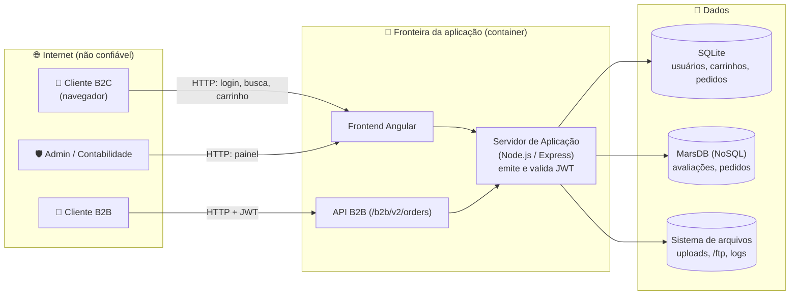

# 🐉 Modelagem de Ameaças (STRIDE) do OWASP Juice Shop — Aula 04

> **Pergunta central da modelagem de ameaças:** *"O que estamos construindo? O que pode dar errado? O que vamos fazer a respeito? Fizemos um bom trabalho?"* (Threat Modeling Manifesto)

O próprio Juice Shop traz um modelo oficial no formato do **OWASP Threat Dragon**: o arquivo `threat-model.json`, na raiz do código-fonte. Ele tem o **diagrama de fluxo de dados (DFD)**, mas **nenhuma ameaça cadastrada**: esse é o nosso exercício.

- Abra em **https://www.threatdragon.com** (versão web) ou no Threat Dragon *desktop* → *Import / Open existing model* → selecione o `threat-model.json`.
- Sem instalar nada? Use o diagrama abaixo (mesmos elementos do modelo oficial).

## 1. O que estamos construindo? (DFD simplificado)

**Fronteiras de confiança** (onde os dados mudam de "dono" e precisam ser validados): Internet → aplicação; aplicação → bancos; aplicação → sistema de arquivos.

## 2. O que pode dar errado? (STRIDE por elemento)

| STRIDE | Pergunta | Ameaça no Juice Shop | Elemento | Caso da aula | Quem detecta na esteira? |
| :-: | :--- | :--- | :--- | :-: | :--- |
| **S**poofing | Alguém se passa por outro? | Login sem senha via SQL Injection (`' OR 1=1--`) | Login → SQLite | **1** | SAST (Semgrep), DAST *full* (ZAP) |
| **T**ampering | Alguém altera dados/código? | Token JWT forjado com a chave privada que está no código | Servidor (JWT) | **2** | Secret Scanning (Gitleaks), regra própria |
| **R**epudiation | Alguém nega o que fez? | Ações administrativas sem log de auditoria confiável (logs acessíveis em `/support/logs`) | Sistema de arquivos | (Aula 05) | Nenhuma ferramenta da esteira → **monitoramento** |
| **I**nformation Disclosure | Algum dado vaza? | Carrinho de outro usuário (BOLA/IDOR); hash MD5 da senha dentro do JWT | API de carrinho / JWT | **4** e **2** | **Nenhuma** (lógica de negócio!) / parcialmente SAST |
| **D**enial of Service | Alguém derruba o serviço? | Upload de arquivo gigante / XML malicioso (XXE) | Upload → FS | (exercício) | DAST *full* (parcial) |
| **E**levation of Privilege | Alguém ganha mais poder? | Biblioteca `jsonwebtoken@0.4.0` com bypass de verificação (CVE-2015-9235) | Dependências | **3** | SCA (Trivy) + **SBOM** |

## 3. O que vamos fazer a respeito? (mitigação → controle automatizado)

| Ameaça | Mitigação no código/arquitetura | Controle DevSecOps que impede a regressão |
| :--- | :--- | :--- |
| SQL Injection | `bind`/`replacements` do Sequelize (Prepared Statement) | Regra Semgrep própria `ipog-sql-concatenada-sequelize` em **bloqueio** |
| Chave no código | Chave em cofre (Secret Manager/Vault) + **rotação** | Gitleaks em bloqueio + regra `ipog-chave-privada-no-codigo` |
| Dependência vulnerável | Atualizar `jsonwebtoken` ≥ 4.2.2 | Gate de SCA: bloqueia CRITICAL **com correção disponível**; exceções com prazo (`trivyignore-exemplo.yaml`) |
| BOLA/IDOR | Verificar se `basket.UserId` == usuário do token | Teste de autorização automatizado (caso de abuso) na esteira |
| Repúdio | Log de auditoria imutável e centralizado | Monitoramento/SIEM (Aula 05) |

## 4. Fizemos um bom trabalho?

- Cada ameaça virou **um teste ou uma regra automática**? Se não, ela vai voltar.
- Quais ameaças **nenhuma ferramenta** pegou? → Elas exigem revisão humana, testes de abuso e monitoramento.
- O modelo deve ser **atualizado a cada mudança relevante** (nova API, novo dado sensível), não feito uma vez e esquecido. Guarde-o **no repositório**, versionado como código.
