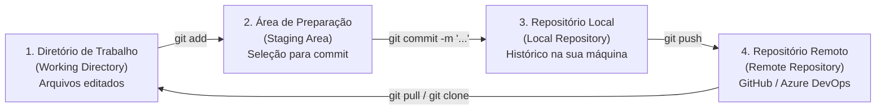

# 🛡️ Ambiente de Desenvolvimento e Operação - DevSecOps (Turma TSC31262R)

Bem-vindos ao repositório prático oficial da disciplina **Ambiente de Desenvolvimento e Operação - DevSecOps** do curso de **Segurança Cibernética do IPOG**!

👨‍🏫 **Professor:** Leandro de Oliveira Santos  
🎯 **Objetivo deste repositório:** Servir como nosso laboratório vivo e colaborativo para praticarmos **Controle de Versão (Git)**, **Infraestrutura como Código (Terraform)** e **Pipelines CI/CD com Quality Gates de Segurança (DevSecOps)**.

---

## 🚀 Como Praticar (Escolha 1 das 2 opções abaixo)

### Opção A: Direto pelo Navegador (Sem instalar nada!) — *Recomendado*
Este repositório já está configurado com **GitHub Codespaces** (um ambiente Linux completo com VS Code, Git e Terraform pré-instalados na nuvem):
1. Clique no botão verde **`<> Code`** no topo desta página;
2. Selecione a aba **`Codespaces`**;
3. Clique em **`Create codespace on main`**;
4. Aguarde ~20 segundos e use o terminal integrado na parte inferior da tela!

### Opção B: Na sua própria máquina (Terminal Local)
Se você já tem o [Git instalado](https://git-scm.com/downloads) no seu computador:
```bash
git clone https://github.com/LeandroOSBr/devsecops-tsc31262r.git
cd devsecops-tsc31262r
```

---

## 🗺️ Estrutura do Repositório

| Pasta | Conteúdo |
| :--- | :--- |
| [`01-pratica-git/`](./01-pratica-git/GUIA_PRATICO_AULA02.md) | Guia passo a passo da prática colaborativa de Git (4 áreas do Git, branches, commits, push e Pull Request) + **Mural da Turma**. |
| [`02-pratica-terraform-iac/`](./02-pratica-terraform-iac/GUIA_TERRAFORM_AULA02.md) | Projetos práticos de **Terraform (IaC)** para AWS (`aws_instance` EC2 Ubuntu `t2.micro` visto na Aula 01) e GCP (VM para o *OWASP Juice Shop*), incluindo boas práticas de segurança. |
| [`.github/workflows/`](./.github/workflows/ci-validacao.yml) | Esteira automatizada (**GitHub Actions**) que é disparada a cada `git push` ou *Pull Request* para validar nossos arquivos e o código Terraform (**Quality Gate**). |

---

## 🔄 Relembrando as 4 Áreas do Git (Aula 01)



---

## 📋 Cola Rápida de Comandos Git (Cheat Sheet)

```bash
# 1. Configurar sua identidade (carimbo nas alterações)
git config --global user.name "Seu Nome"
git config --global user.email "seu.email@exemplo.com"

# 2. Verificar o estado atual dos arquivos (em qual área estão)
git status

# 3. Atualizar seu repositório local com as novidades do servidor remoto
git pull

# 4. Criar e mudar para uma nova ramificação (branch) de trabalho isolada
git checkout -b aluno/seu-nome

# 5. Adicionar arquivos modificados para a área de Staging
git add nome-do-arquivo.md
# Ou adicionar todas as alterações da pasta atual:
git add .

# 6. Gravar o pacote de alterações no Repositório Local com uma mensagem clara
git commit -m "feat: adiciona meu perfil no mural da turma"

# 7. Enviar seus commits locais para o Repositório Remoto (GitHub)
git push -u origin aluno/seu-nome

# 8. Consultar o histórico de alterações
git log --oneline --graph --all
```

---

## 🎮 Ferramentas Complementares para Praticar em Casa

* 🧩 **[Learn Git Branching (Em Português)](https://learngitbranching.js.org/?locale=pt_BR):** Simulador visual e interativo direto no navegador para dominar `commit`, `branch`, `merge`, `rebase` e `push`/`pull` em formato de desafios passo a passo.
* 🎓 **[GitHub Skills - Introduction to GitHub](https://github.com/skills/introduction-to-github):** Curso prático oficial do próprio GitHub.
* 📄 **[Git Cheat Sheet Oficial (PDF em Português)](https://training.github.com/downloads/pt_BR/github-git-cheat-sheet.pdf):** Folha de consulta rápida com os principais comandos.
* 🧃 **[OWASP Juice Shop](https://owasp.org/www-project-juice-shop/):** Aplicação web vulnerável que utilizaremos nos nossos testes de pipeline e ferramentas SAST/DAST/SCA.
